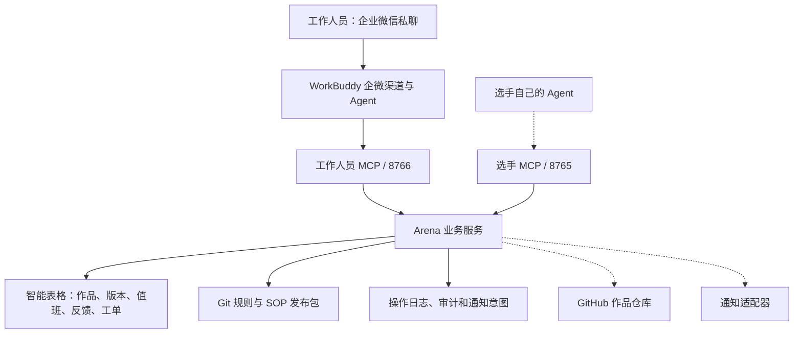

# Arena · ANC 比赛运行层 Demo

Arena 将比赛中的作品提交、查询、规则答疑、值班协调和异常处理连接成一个可审计的运行层。工作人员通过企业微信与 WorkBuddy 交互；Arena MCP 负责权限判断、确定性业务校验、台账写入和工单状态，模型不能绕过服务端规则。

当前版本：`0.3.0.dev1`。完整方案与系统设计见 [WorkBuddy 与 ANC 实施方案](https://app.notion.com/p/407a4d98cffb81229afdfcafdfa0010b) 和 [搭建复盘](docs/anc-build-retrospective.md)。

## 当前状态

已真实验证：

- WorkBuddy 桌面连接本机工作人员 MCP，真实模型调用 `search_works` 返回 `H-001 / RAG 知识助手`。
- 用户授权 WorkBuddy 接管原 `test机器人` 后，企业微信私聊完成只读查询；内部详情被服务端身份校验拒绝。
- 独立五表智能表格沙盒完成登记故障修复、重试去重、排班修改读回和工单生命周期验证。
- 76 项 `pytest`、`ruff`、`mypy` 及 25/25 确定性服务 Evals 通过。Evals 不调用模型。

尚未完成正式赛时验收：

- 企业微信群 @、多用户会话隔离和可信 sender 身份透传。
- GitHub App 向专用作品仓库的真实写入；当前仅完成 Mock HTTP 测试。
- 真实通知投递与接收人回执。
- 正式 Owner/Reviewer 审批、真实 Agent 基线和 5–10 人赛前演练。

当前保持公共只读。不能根据本机私聊结果宣布正式赛事全量切换。详细边界见 [v0.3 状态](docs/v03-status.md)和[企微私聊验收记录](docs/v03-wecom-acceptance.json)。

## 架构



职责边界：

- **WorkBuddy** 负责工作人员侧的对话、工具选择和结果组织。
- **选手 Agent** 通过选手 MCP 提交作品，业务身份来自服务端验证的 Bearer 凭据。
- **Arena** 负责版本分配、文件检查、作品范围权限、DRI 工单状态机和幂等恢复。
- **智能表格** 保存作品、版本、值班、反馈和工单等运营台账。
- **Git** 保存规则与 Skills 的已发布版本；比赛示例内容必须由主办方替换。
- **GitHub** 将保存作品文件和 commit/tag 证据；正式写入尚未配置。

本项目采用 ANC 的共享 Context、Skills、动态 DRI、反馈与 Evals 思路，并针对赛事场景做了独立实现。与调研的对应关系、借鉴内容和本项目设计详见[搭建复盘](docs/anc-build-retrospective.md)。

## 快速开始

需要 Python 3.12、[uv](https://docs.astral.sh/uv/) 和 PowerShell。

```powershell
# 安装锁定依赖并运行测试
.\Run-Demo.ps1 -Mode verify

# 仅检查 v0.3 配置，不写表格、不调用外部模型
.\Run-Demo.ps1 -Mode doctor-v03

# 启动工作人员 MCP，默认端口 8766，写操作关闭
.\Run-Demo.ps1 -Mode workbuddy-poc
```

`workbuddy-poc` 只对当前进程设置智能表格 Registry、公共只读身份和关闭写入；结束后恢复原环境变量。不要同时启动第二个工作人员 MCP，也不要让旧机器人与 WorkBuddy 争用同一 Bot 长连接。

在 WorkBuddy 的 MCP 配置中加入：

```json
{
  "mcpServers": {
    "arena-local": {
      "type": "streamable-http",
      "url": "http://127.0.0.1:8766/mcp",
      "timeout": 60
    }
  }
}
```

首次连接需由用户在 WorkBuddy 界面确认信任。WorkBuddy 配置、五项 Skill 草案和运行说明见 [workbuddy/README.md](workbuddy/README.md)。

## 服务入口

| 服务 | 默认地址 | 用途 |
| --- | --- | --- |
| 选手 MCP | `http://127.0.0.1:8765/mcp` | 提交作品、查询本队作品与版本 |
| 选手健康检查 | `http://127.0.0.1:8765/healthz` | 本机业务状态，不等于外部渠道全链路正常 |
| 工作人员 MCP | `http://127.0.0.1:8766/mcp` | 公共查询及受控工作人员工具 |
| 工作人员健康检查 | `http://127.0.0.1:8766/healthz` | 当前进程、注册表和写开关状态 |

本机原生企微渠道可以访问 localhost MCP。远程选手或云端 Agent 接入时，需要另行部署已验证的 HTTPS MCP；当前没有公网在线演示地址。

## 配置与安全

凭据只通过本机环境变量传入，不写入源码、日志、智能表格或文档。变量名见 [.env.example](.env.example)；不要提交实际 `.env` 文件。

主要配置：

| 变量 | 用途 |
| --- | --- |
| `ARENA_REGISTRY` | `local` 或 `smartsheet` 业务台账 |
| `ARENA_WRITER` | `local` 或 `github` 作品写入器 |
| `ARENA_TEAM_CREDENTIALS` | 队伍凭据摘要映射 |
| `ARENA_STAFF_CREDENTIALS` | 工作人员 token 摘要、角色和作品范围 |
| `ARENA_STAFF_WRITES_ENABLED` | 工作人员写操作服务端开关 |
| `ARENA_SMARTSHEET_WRITES_ENABLED` | 智能表格写操作服务端开关 |
| `GITHUB_APP_ID` / `GITHUB_INSTALLATION_ID` | GitHub App 安装身份 |
| `GITHUB_APP_PRIVATE_KEY` | 仅从本机环境读取的 GitHub App 私钥 |

服务端不信任聊天文本、模型参数或客户端自报的 `userid`/`role`。修改凭据后重启对应服务；日志不得记录认证头。

## 外部系统状态

| 系统 | 当前状态 | 尚未完成 |
| --- | --- | --- |
| WorkBuddy 桌面 | 真实模型与只读 MCP 已通过 | Enterprise 或云端席位资格 |
| 企业微信 | 原测试机器人私聊只读闭环已通过 | 群 @、多人隔离、sender 透传、重连稳定性 |
| 企业微信智能表格 | 原测试表只读；独立五表沙盒读写通过 | 正式台账迁移与通知回执 |
| GitHub | App Writer 代码和 Mock 故障测试完成 | App 凭据、专用仓库、真实 commit/tag |
| 模型 | WorkBuddy 桌面真实模型调用通过 | 正式模型路由、配额和成本验收 |
| 通知 | outbox、状态和重试边界已实现 | 真实 Provider 投递和接收人确认 |
| 公网 MCP | 本机 HTTP 联调通过 | HTTPS 地址、访问认证与网络验证 |

## 开发与验证

```powershell
uv run pytest -q
uv run ruff check .
uv run mypy src
uv run python evals/run.py
```

测试默认禁止外网访问；只有 localhost MCP 协议测试使用真实 TCP。模型失败路径使用假响应，不得作为真实模型验收。外部系统失败时保留本地证据，不用 Mock 结果冒充正式作品或消息记录。

完整运行、切换和回滚步骤见 [v0.3 运行手册](docs/v03-runbook.md)。工作人员工具输入输出及错误约定见 [工作人员 MCP 契约](docs/staff-mcp-contract.md)。

## Demo 与文档

- [代码仓库](https://github.com/Eevanes/ABF_demo)（私有）
- [v0.3 交付 PR](https://github.com/Eevanes/ABF_demo/pull/1)
- [v0.3 验收状态](docs/v03-status.md)
- [ANC 搭建复盘](docs/anc-build-retrospective.md)
- [工作人员接入说明](docs/staff.md)
- [选手接入说明](docs/participant.md)
- [智能表格结构](docs/smartsheet-schema.md)
- [Notion 方案](https://app.notion.com/p/407a4d98cffb81229afdfcafdfa0010b)
- [Notion 搭建复盘](https://app.notion.com/p/407a4d98cffb8135a463f85b62f4e7fd)

## v0.2 历史能力

v0.2 已完成本机提交、版本、查询、规则答疑、值班和反馈的基础演练，并保留旧机器人、云端镜像和本地 SQLite 兼容路径。v0.3 在这些确定性业务逻辑上增加独立工作人员 MCP、智能表格 Registry、GitHub App Writer、恢复对账和 DRI 工单。

旧模式仍可用于受控回退，但外部状态以 v0.3 状态文件和当前探针为准：

```powershell
.\Run-Demo.ps1 -Mode mcp-walkthrough
.\Run-Demo.ps1 -Mode serve
```

## 来源

- [ANC 概念调研](https://app.notion.com/p/406a4d98cffb80aca765c48f98108870)
- [Arena 技术调研](https://app.notion.com/p/033a670eaaf64451ab1a18adf4536b26)
- [初版搭建规格](https://app.notion.com/p/3945e01d2d8349609df852f82d43d4ef)
- [ANC 开源项目](https://github.com/HA7CH/ai-native-company)
- [企业微信官方 CLI](https://github.com/WecomTeam/wecom-cli)
- [MCP Python SDK](https://github.com/modelcontextprotocol/python-sdk)
- [DeepSeek Tool Calls](https://api-docs.deepseek.com/guides/tool_calls/)
