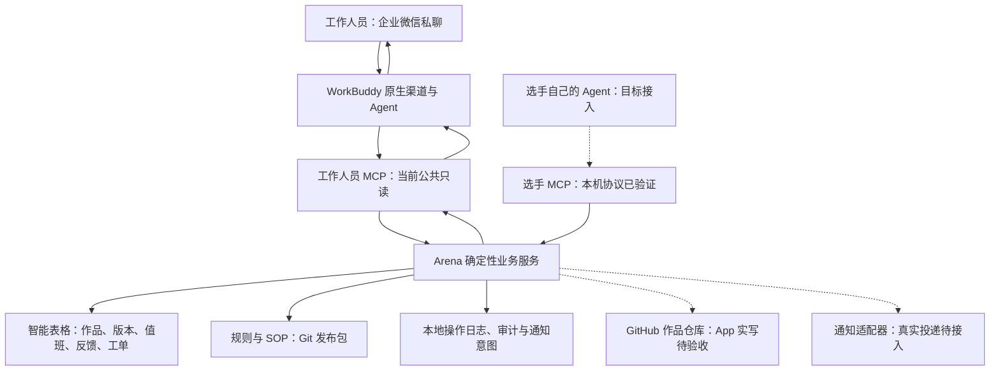

# Arena：从 ANC 技术调研到可运行 Demo

更新日期：2026-10-28。版本：`0.3.0.dev1`。本文整理本轮设计、搭建过程与分层验收结果，代码证据基线为 `bb467f3`。

[Notion 阅读版](https://app.notion.com/p/407a4d98cffb8135a463f85b62f4e7fd)

## 1. 我们正在搭什么，已经走到哪里

Arena 的目标是把比赛中的提交检查、作品查询、规则答疑、值班协调和异常处理连接成一个运行层，让少量固定人员制定规则、裁决例外，流动工作人员按岗位和时段处理具体事项。原调研提出的“2–3 个固定人员支撑大型比赛”仍是待验证的运营目标，目前没有人数节省、培训时长或大型赛事稳定性实测。

目前已完成核心业务代码、独立工作人员 MCP、真实智能表格沙盒验证，以及“企业微信私聊 → WorkBuddy → Arena MCP → 企业微信回复”的公共只读闭环。GitHub App 正式作品写入、多人身份隔离、真实通知回执及完整反馈发布闭环仍待联调，因此当前是可运行、可复核的 Demo，尚未达到正式办赛全量验收。

依据：[原技术调研](https://app.notion.com/p/033a670eaaf64451ab1a18adf4536b26)、[v0.3 实施方案](https://app.notion.com/p/407a4d98cffb81229afdfcafdfa0010b)、[当前交付状态](https://github.com/Eevanes/ABF_demo/blob/bb467f3/docs/v03-status.md)。

## 2. ANC 给了我们什么，Arena 如何应用

ANC 调研把组织运行拆为模型、Harness、Gateway、Context、Skills、权限审计与反馈。我们沿用其中的组织思路：共享事实、可复用流程、明确责任，以及从失败中改进。开源 ANC 的轻形态也允许个人 Agent 接入共享知识，托管形态复用现成 Harness 和消息入口。Arena 采用这些原则进行赛事场景的独立实现；当前仓库没有直接安装 ANC 软件包，也没有部署它的完整 bot 矩阵。[ANC 开源说明](https://github.com/HA7CH/ai-native-company)

| ANC 层次 | Arena 中的对应实现 | 要带来的功能 | 当前证据与边界 |
| --- | --- | --- | --- |
| 模型 | WorkBuddy 提供模型调用；桌面联调用 Hy3 | 理解自然语言、选择工具、组织回复 | 已发生真实模型工具调用；没有把旧 DeepSeek 假响应测试算成真实模型验收 |
| Harness | 工作人员侧由 WorkBuddy 承担；选手使用自己的 Claude Code / Cursor 等 | 接收任务、调用 MCP、返回结果 | WorkBuddy 桌面及企微私聊公共查询通过；选手远程客户端尚未实测 |
| Gateway | 工作人员走 WorkBuddy 原生企业微信渠道；选手走独立 MCP | 沿用既有工作入口 | 私聊通过；群 @ 尚未验证 |
| Context | 智能表格业务台账、作品版本证据、Git 管理的规则发布包 | 查到同一份作品、排班和生效规则 | 原测试表只读与独立五表沙盒读写通过；GitHub 作品归档待真实配置 |
| Skills | 五项 WorkBuddy Skill 草案和工具契约 | 查作品、提交指导、志愿者 SOP、异常升级、反馈复盘 | 文件及服务评估已有；未宣称五项 Skill 都已在真实 WorkBuddy 中触发验收 |
| 权限与审计 | 选手/工作人员 MCP 分离；服务端身份和作品范围复验；操作日志 | 只能查看和修改被授权的数据 | 匿名内部详情拒绝已在企微实测；可信 sender 透传仍未证明，写入关闭 |
| DRI | 值班查询、唯一负责人、工单状态机、超时升级 | 问题有人接、有人处理、有依据结案 | 真实沙盒工单闭环通过；通知到人及换班真人演练待做 |
| 反馈与 Evals | 反馈审查、改进草案、固定题集、人工审核发布规范 | 把一次失败转成下一次可复用能力 | 25/25 确定性服务评估；真实 Agent 基准题和审批发布闭环待做 |

## 3. 当前架构：Agent 负责理解，Arena 负责可核验执行



图中企业微信私聊、WorkBuddy 和本机 MCP 已真实联通；智能表格写入与工单生命周期是在另一份独立五表沙盒中验证，不能把它们拼成“当前机器人已经能处理全部工作人员业务”。

选手提交时，由服务端根据队伍凭据识别作品，不让模型随意指定别队的作品 ID；工作人员查询时，由服务端决定可见字段。WorkBuddy 即使理解错了意图，也不能靠一段聊天自报身份获得工作人员权限。[身份决策](https://github.com/Eevanes/ABF_demo/blob/bb467f3/docs/ADR-003-mcp-identity.md)

业务事实按用途分开：智能表格维护作品、版本、值班、反馈和工单；GitHub 目标上维护作品文件及 commit/tag；Git Markdown 维护规则和 Skills；本地操作日志只保存恢复阶段、审计和通知意图。ima 仍是未来已发布知识副本的候选，尚未接入。[存储与恢复决策](https://github.com/Eevanes/ABF_demo/blob/bb467f3/docs/ADR-002-registry-recovery.md)

## 4. 我们怎样一步步搭起来

| 阶段 | 实际工作与取舍 | 得到的结果 |
| --- | --- | --- |
| 业务拆解 | 从“办赛需要人传话和核对”切入，先选提交、查作品、规则、值班四类高频流程 | 明确组织问题和首批能力，先不做完整管理后台 |
| v0.2 本地业务基线 | Python/FastMCP、队伍鉴权、提交校验、SQLite、本地真实 Git commit/tag、规则检索、旧机器人适配 | 先把编号、版本、权限及失败行为做成确定性逻辑 |
| 第一轮企微接入 | CLI 授权、四张真实测试子表、原 test机器人单聊、云端镜像及别名回流 | 证明原入口能收发并查到 H-001；当时回复明确标为离线演练，未当成真实模型结果 |
| v0.3 拆分执行层 | 新增工作人员 MCP，把查询服务从旧 Harness 中分离；保留已验证的提交逻辑 | WorkBuddy 可以替换工作人员 Agent 执行，而不重写业务规则 |
| 台账与可靠性 | Registry/Writer 抽象、SmartSheetRegistry、GitHubAppWriter、持久化操作日志、重试与对账 | 独立五表沙盒验证漏登记修复、重试去重和直接修改排班后的读回；GitHub Writer 仍为模拟 HTTP 测试 |
| DRI 与反馈 | 新增工单、唯一负责人、接单到结案状态流、outbox 和改进草案 | 真实表格沙盒经官方 MCP 客户端完成工单闭环；没有真实通知 Provider，通知保持 queued |
| WorkBuddy 桌面联调 | 恢复主界面、配置 arena-local、用户完成首次信任、真实 Hy3 查询 | 返回 H-001；内部详情被拒绝。此前“启动退出”观察不再作为当前阻塞 |
| 企微原生渠道联调 | 用户扫码授权原 test机器人并明确让 WorkBuddy 接管；检查旧接收服务状态；用户发送只读测试 | 企业微信收到正确查询与权限拒绝回复，后台同期出现两次 MCP 调用 |

迁移过程中没有删除原机器人资料和历史，没有迁移原测试表为正式赛场台账。原 `8765` 接收服务在接管前不可达，未执行停止旧进程操作；当前 MCP 使用 `8766`。旧代码仍保留作受控回退，不应再与 WorkBuddy 争用同一机器人的连接。[接入决策与过程](https://github.com/Eevanes/ABF_demo/blob/bb467f3/docs/ADR-001-workbuddy-runtime.md)

## 5. 用 ANC 实现的具体业务流程

### 5.1 选手提交：固定作品身份，版本和证据由系统生成

目标流程：选手对自己的 Agent 说“提交新版本” → 调用选手 MCP → Arena 检查 README、文件、截止时间、凭据和重复内容 → 写作品版本 → 登记台账 → 返回固定作品 ID、版本和证据。

本地提交和官方 MCP 协议已经验证。正式链路仍需配置 GitHub App、专用作品仓库与远程 HTTPS MCP，再用真实 Claude Code / Cursor 提交。`repo_url` 大作品拉取尚未完成，不能把当前能力描述成任意仓库一键提交。

### 5.2 工作人员查询：先查事实，再按权限回答

本轮真实消息要求查询“山海队”的编号和名称，再尝试读取内部详情。企业微信实际回复 `H-001 / RAG 知识助手`；详情返回“需要独立认证的工作人员身份”。后台在北京时间 `20:42:36` 与 `20:42:42` 记录两次 `CallToolRequest`。服务日志本身不含工具名，具体查询和拒绝内容来自企业微信回复读回，并由用户确认收到。

这证明了公共查询和匿名权限拒绝，也证明本机原生企微渠道可以使用 localhost MCP；它没有证明群聊、多用户隔离或工作人员身份透传。[真实私聊验收](https://github.com/Eevanes/ABF_demo/blob/bb467f3/docs/v03-wecom-acceptance.json)

### 5.3 异常处理：从“转给某人”升级为可追踪工单

目标流程：发现作品版本不一致 → 建工单 → 按类别和当前值班确定 DRI → 通知 → 接单 → 处理 → 附依据解决 → 请求人或管理员结案。无人值班、接单超时和待复核都需要明确状态。

当前真实沙盒已完成创建、重试去重、接单、处理、解决、结案读回；仍缺真实通知投递和接收人确认。因此现在能说“工单记录闭环已验证”，不能说“机器人已通知当班人员”。[沙盒 MCP 工单验收](https://github.com/Eevanes/ABF_demo/blob/bb467f3/docs/v03-cloud-mcp-acceptance.json)

### 5.4 组织改进：失败先形成草案，再审核发布

目标流程：收集失败、差评和升级问题 → Owner 判断是缺知识、Skill、数据还是流程 → 形成改进 → Reviewer 审核 → 同题集回归 → 发布新版本 → 观察复发率。

当前有反馈审查和 `propose_change` 草案能力；它不会自动创建远端 GitHub Issue，也不会发布规则。五项 Skill 的 Owner/Reviewer 仍待主办方指定，示例知识尚不能直接作为正式赛事政策。[Skill 接入包](https://github.com/Eevanes/ABF_demo/tree/bb467f3/workbuddy)

## 6. 哪些是借鉴，哪些是我们的具体设计

这里的“自己的想法”指本项目面向办赛的产品选择与工程实现，不代表宣称这些通用机制由我们原创。

| 借鉴的 ANC 思路 | 我们做出的具体设计 | 为什么适合当前场景 |
| --- | --- | --- |
| 共享 Context，避免组织事实散落在聊天里 | 按数据类型分权威源：智能表格业务台账、Git 规则包、GitHub 作品证据 | 运营人员能直接看表，同时保留版本和判定依据 |
| 复用现成 Harness 和消息渠道 | 工作人员使用 WorkBuddy，选手保留自己的 Agent，两侧通过独立 MCP 接入 Arena | 减少维护自研 Agent 循环的成本，并保留清晰权限边界 |
| Skills 沉淀组织能力 | 五类赛事 Skill 与服务端契约绑定，流程指导和真实业务校验分开 | 更换模型或入口时仍可保留提交与工单规则 |
| 动态 DRI 对结果负责 | “值班时段 + 事项类别 + 唯一工单负责人 + 接单/结案证据” | 流动志愿者可以轮班，但未完成问题不会因换班失去责任人 |
| 知识与工作流状态需要区别对待 | 选择智能表格作运营台账，再用操作日志、单实例锁、幂等键和对账弥补跨系统失败 | 适配人员已有工具；同时承认表格不是事务数据库，多机写入尚不支持 |
| 可审计、可恢复的执行 | 固定作品 ID、版本 tag、submission_id 和提交元数据关联；Git 已成功时补登记，不重复上传 | 处理“文件已保存但台账失败”，减少重复版本和人工对账 |
| 规则需要治理 | 只加载有审批、生效时间及哈希的发布包；服务加载固定快照，改版重启并评估 | 避免草稿或示例混入正式答复；尚未宣称所有跨天任务都有独立规则冻结生命周期 |
| 反馈产生能力复利 | 区分服务测试、真实模型调用、企微收发和运营效果；改进只先生成草案 | 避免把测试通过等同于现场可用，也避免机器人自行改规则 |

其中“知识用文件、状态用事务”、规则冻结及对话层与任务层分离，已经在 ANC 制造企业试点中讨论过，属于明确借鉴。我们的变化在于赛事业务建模、企业微信智能表格适配及 Arena 服务边界。当前表格、审计和 outbox 跨系统操作不具备同一数据库事务的原子性；不能直接套用试点的事务保障结论。[ANC 制造企业试点经验](https://github.com/HA7CH/ai-native-company/blob/main/docs/LESSONS-MANUFACTURING-PILOT.md)

与初版方案相比，另有两项明确调整：原计划自研工作人员 Harness，现改为 WorkBuddy；原计划新建独立 Bot，本轮用户明确选择沿用原 test机器人。后一项是部署选择的变更，不是“已经创建独立机器人”。

## 7. 验证到了哪一层

| 验证层 | 已有记录 | 不能据此推出 |
| --- | --- | --- |
| 自动化业务检查 | 76 项 pytest；ruff/mypy 通过 | 外部平台及真实模型全部可用 |
| 固定服务 Evals | 25/25；不调用模型 | 真实 Agent 对 25 道题都回答正确 |
| 真实智能表格 | 独立五表、故障补登记、排班修改读回、工单生命周期 | 正式数据迁移已经完成，或通知已经到人 |
| WorkBuddy 桌面 | 真实模型查询及匿名内部详情拒绝 | 企业微信所有角色和场景均已验证 |
| 企业微信私聊 | 用户实际发送并收到回复，后台同期 MCP 调用 | 群 @、多用户会话隔离、staff 身份与写操作可用 |
| 正式运营效果 | 尚未开展 5–10 人完整演练和现场运行 | 已减少多少人员、答疑时间或异常处理成本 |

自动化数量来自本轮已有验收报告，本次文档整理没有重新运行测试。[自动化报告](https://github.com/Eevanes/ABF_demo/blob/bb467f3/docs/v03-verification.json) 中企微字段是较早阶段快照；渠道结论以较晚的 [私聊验收报告](https://github.com/Eevanes/ABF_demo/blob/bb467f3/docs/v03-wecom-acceptance.json) 为准。

## 8. Demo 与复现入口

- [当前 v0.3 代码 Demo](https://github.com/Eevanes/ABF_demo/tree/feat/arena-v03-workbuddy-anc)：当前工作分支；仓库为私有，需要已有访问权限。
- [本轮交付 PR #1](https://github.com/Eevanes/ABF_demo/pull/1)：查看迭代范围与代码差异；当前交付仍在分支上。
- [固定验收代码快照 bb467f3](https://github.com/Eevanes/ABF_demo/tree/bb467f3)：对应本文采用的实测记录。
- 交互 Demo：在已授权的企业微信账号中私聊原 `test机器人`；需要本机 Arena 和 WorkBuddy 保持运行。
- 本机 MCP：`http://127.0.0.1:8766/mcp`；健康检查：`http://127.0.0.1:8766/healthz`。它们仅指向使用者自己的电脑，不是可供外部访问的在线演示链接。

本机已有环境配置后，在仓库根目录启动：

```powershell
.\Run-Demo.ps1 -Mode workbuddy-poc
```

随后使用 WorkBuddy 已配置的 `arena-local`，私聊测试机器人查询山海队作品。新电脑还需单独配置平台授权和本机环境变量；文档不附凭据。当前没有已部署的公网在线 Demo 页面，也没有公网 MCP 地址。

## 9. 下一轮应完成什么

1. 保持公共只读，验证群 @、不同用户会话隔离和可验证 sender 身份；通过后才考虑工作人员受控写入。
2. 配置 GitHub App 和专用作品仓库，跑一次真实提交、tag、智能表格登记及故障恢复；远程选手或云端 Agent 接入时再配置 HTTPS MCP。
3. 接入真实通知 Provider，区分 queued、平台已接收与人已接单，完成一次带回执的 DRI 异常处理。
4. 指定规则 Owner/Reviewer，替换示例规则，完成至少一次“反馈 → 改进 → 审核 → 发布 → 回归”。
5. 组织 5–10 人完整演练，并记录直接解决率、转人工率、接单/解决时间、培训时长和异常复发率。用这些数据检验 ANC 是否降低协调成本。

## 10. 调研与证据索引

- [ANC 概念调研](https://app.notion.com/p/406a4d98cffb80aca765c48f98108870)
- [原技术调研](https://app.notion.com/p/033a670eaaf64451ab1a18adf4536b26)
- [初版搭建规格](https://app.notion.com/p/3945e01d2d8349609df852f82d43d4ef)
- [v0.3 实施方案](https://app.notion.com/p/407a4d98cffb81229afdfcafdfa0010b)
- [ANC 开源项目](https://github.com/HA7CH/ai-native-company)、[制造企业试点经验](https://github.com/HA7CH/ai-native-company/blob/main/docs/LESSONS-MANUFACTURING-PILOT.md)
- [WorkBuddy 官方企微接入说明](https://www.workbuddy.cn/docs/workbuddy/Wecom-Guide)：支持长连接和扫码绑定，桌面需保持运行；官方能力描述不能替代本机验收。
- [验收状态与报告目录](https://github.com/Eevanes/ABF_demo/tree/bb467f3/docs)、[工作人员 MCP 契约](https://github.com/Eevanes/ABF_demo/blob/bb467f3/docs/staff-mcp-contract.md)
